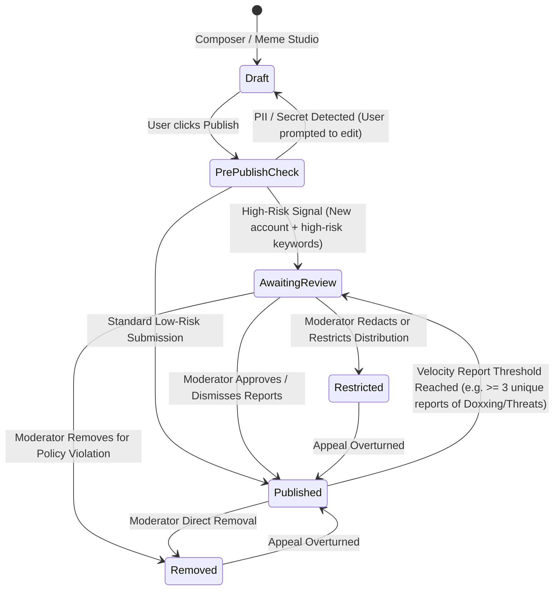

# Trust, Safety, Security & Moderation Architecture

**Document ID:** ARCH-PO-009  
**Version:** 2.0.0  

## 1. Balancing Candid Expression with Harm Prevention

Pressure Out exists so working people can voice honest frustrations, share satire, critique broken workplace cultures, and talk openly about salaries and layoffs. However, an anonymous workplace platform that fails to stop **doxxing, targeted harassment of named private individuals, credible threats, or confidential credential leaks** will quickly face legal liability and community toxicity.

Our architecture enforces a **clear line**:
* **Protected & Encouraged:** Venting about workload, management styles, return-to-office mandates, interview ghosting, compensation disparities, office politics, and satire/memes.
* **Strictly Prohibited:** Publishing personal contact details (doxxing), naming and defaming non-public individual coworkers/managers, credible threats of violence or self-harm, hate speech, non-consensual imagery, confidential client source code/keys, and coordinated brigading/spam.

## 2. Content Lifecycle & Risk-Based Moderation

Not every post requires manual pre-moderation before appearing in the feed. Pressure Out uses a **risk-tiered content state machine**:

### 2.1 Pre-Publish PII & Secret Guardrail (`app/modules/posts/pii_guard.py`)
Before a post or comment is persisted, a synchronous server-side guardrail scans the text for high-risk patterns:
1. **Hard Block (Never Published):** API keys/secrets (`AKIA...`, `ghp_...`, private SSH keys), credit card numbers (Luhn check), national ID patterns (Aadhaar/SSN formats), and personal phone numbers or personal email addresses.
2. **Soft Warning (Requires Explicit User Confirmation or Edit):** Patterns matching `"My manager [Capitalized First Last] at [Company]"` or internal corporate URLs. The API returns `422 PII_CONFIRMATION_REQUIRED` with suggested role generalizations (e.g., *"Consider replacing names with role titles like 'my Engineering Director'"*).

### 2.2 Reporting, Triage & Velocity Safeguards
* **Structured Reporting:** Authenticated users submit reports via `POST /api/v1/reports` with reason codes (`doxxing_pii`, `harassment`, `threat`, `impersonation`, `spam`, `hate_speech`, `confidential_ip`, `misleading_allegation`, `other`).
* **Automated Priority Scoring:** Reports for `doxxing_pii` and `threat` receive `priority_score = 10` (top of queue). If a single post receives **≥ 3 unique user reports for `doxxing_pii` or `threat`** within 30 minutes, its `moderation_status` automatically transitions from `published` to `awaiting_review` (temporarily hidden from public feeds until a moderator reviews it).
* **Downvotes != Fakery:** In accordance with product principles, negative vote scores (`score < 0`) never automatically delete a post or label a workplace story as "false."

## 3. Role-Based Access Control (RBAC) & Moderator Privacy Boundaries

Moderators are essential for community safety, but they must **never** be able to abuse their role to unmask anonymous authors.

| Capability / Data Access | Regular Member | Community Moderator (`c/[slug]`) | Global Moderator | System Admin (Audited) |
| :--- | :--- | :--- | :--- | :--- |
| Create posts, comments, memes, reports | Yes | Yes | Yes | Yes |
| View Moderation Queue for assigned community | No | Yes | Yes (All communities) | Yes |
| Remove/Restrict post or comment in scope | Own content only | Within assigned `c/[slug]` | All communities | All communities |
| Issue temporary account cooldown (`user_cooldown`) | No | Community mute only | Platform-wide cooldown | Platform-wide suspend |
| Review user Moderation Appeals | No | No (Prevents self-review bias) | Yes (Different moderator than original actor) | Yes |
| **See `author_user_id`, `@handle`, email, or IP on Anonymous Posts** | **NEVER** | **NEVER** | **NEVER** | **NEVER in UI** (Break-glass legal hold only via audited CLI) |
| View `audit_events` security log | No | No | No | Yes (Read-Only) |

### 3.1 Appeals & Multilingual Moderation Safeguards
* **Right to Appeal:** Every `moderation_action` that restricts or removes content generates an in-app notification to the author with the `public_explanation` and a button to submit one `moderation_appeals` record. Appeals must be reviewed by a different moderator than the one who took the initial action.
* **Multilingual & Slang Protection:** Moderators can filter the queue by `content_language`. If a moderator does not read the language of a reported post, they must click **Escalate — Language Specialist Needed** rather than guessing or treating regional slang/informal grammar as abuse by default.

## 4. Application Security Controls Matrix

| Threat Vector | Technical Mitigation in Pressure Out |
| :--- | :--- |
| **Public API Identity Leakage** | Dedicated `PublicPostResponse` / `PublicCommentResponse` Pydantic schemas that omit private fields at the type level, verified by automated CI security tests. |
| **Cross-Site Scripting (XSS)** | React escapes rendered text by default; backend sanitizes any rich text/markdown AST; strict `Content-Security-Policy` headers disallow inline scripts. |
| **Cross-Site Request Forgery (CSRF)** | `SameSite=Lax` + `HttpOnly` session cookies paired with mandatory `X-CSRF-Token` header verification on all state-changing endpoints. |
| **SQL Injection** | 100% parameterized queries via SQLAlchemy 2.0 ORM/Core; zero string-interpolated SQL. |
| **Malicious File Uploads / Image Exploits** | Users in MVP do not upload arbitrary raw files to feeds; Meme Studio validates magic bytes, re-encodes images via Pillow (stripping EXIF/metadata payloads), and stores files in private Object Storage with `Content-Disposition: inline` and `X-Content-Type-Options: nosniff`. |
| **Credential Stuffing & Brute Force** | Argon2id password hashing + account/IP rate limiters (`10 login attempts / 15m`, `5 anonymous posts / 15m`) + session revocation on password reset. |
