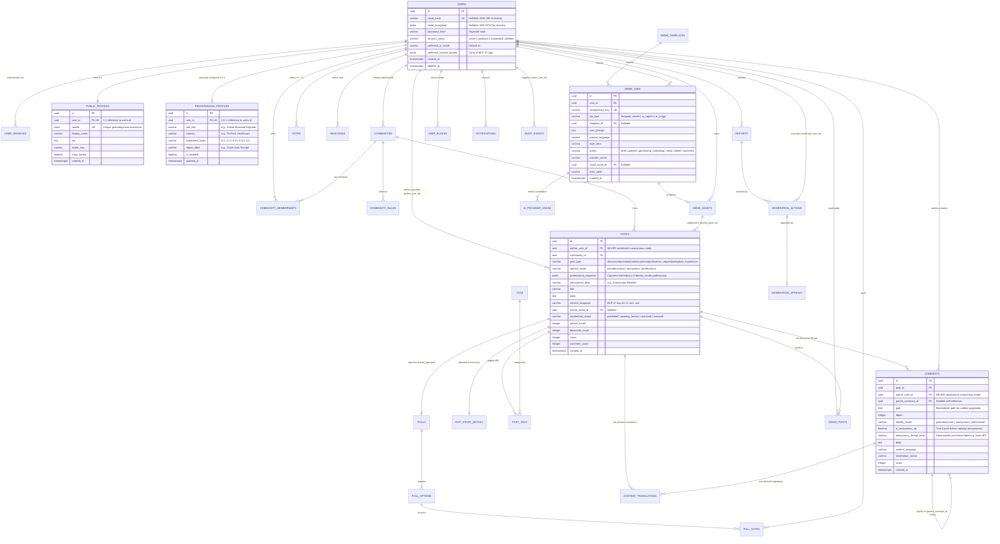

# Database Entity Relationship Diagram (ERD)

**Document ID:** DIAG-PO-003  
**Related Spec:** [DATABASE_DESIGN.md](../architecture/DATABASE_DESIGN.md)

## 1. Relational Entity Diagram (Diagram 3)

This Mermaid Entity Relationship Diagram models the core PostgreSQL tables, highlighting how **private authentication identity** (`users`, `user_sessions`) is decoupled from **public profiles** (`public_profiles`, `professional_profiles`) and how `posts` and `comments` preserve private ownership (`author_user_id`) while enforcing explicit public `identity_mode` rendering.

