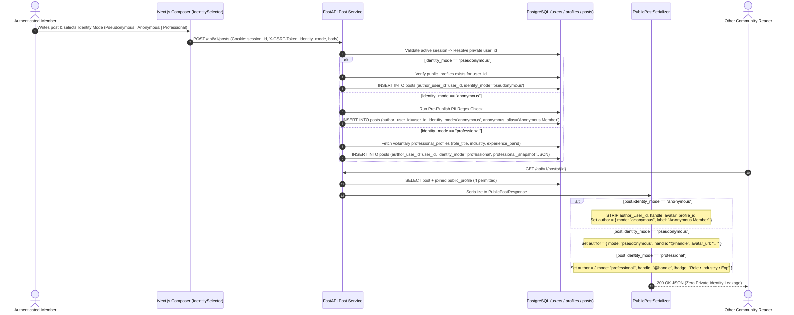

# Authentication, Public Identity & Anonymous Posting Flows

**Document ID:** DIAG-PO-004  
**Related Spec:** [IDENTITY_AND_PRIVACY.md](../architecture/IDENTITY_AND_PRIVACY.md)

## 1. Authentication & Three-Mode Identity Resolution Flow (Diagram 4)

This diagram illustrates how a single private account (`users.id`) authenticates once and dynamically selects between **Pseudonymous**, **Anonymous**, and **Professional** identity representations per post or comment.



## 2. End-to-End Anonymous Posting, OP Reply & Moderation Boundary Flow (Diagram 5)

This flowchart shows how **Anonymous Posts** preserve private ownership for the author (editing, deleting, notifications, and sticky `Anonymous OP` replies) and enforce strict access boundaries for moderators.

```mermaid
flowchart TD
    subgraph AuthorActions["1. Author Creation & Ownership"]
        A[Author selects 'Anonymous' Mode in Composer] --> B[Pre-Publish PII Guard scans for Emails / Phones / Names]
        B -->|Warning Triggered| C[User edits text or acknowledges warning]
        B -->|Clean| D[FastAPI saves Post with private author_user_id + identity_mode='anonymous']
        C --> D
    end

    subgraph ThreadReply["2. Sticky Anonymous OP Reply Protection"]
        D --> E[Author opens their own Anonymous Post thread to reply]
        E --> F[Frontend & Backend detect current_user.id == post.author_user_id]
        F --> G[Comment Composer auto-locks to 'Anonymous OP']
        G --> H{Does Author try to switch to @handle?}
        H -->|No| I[Reply saved as 'Anonymous OP' — Zero Handle Exposure]
        H -->|Yes| J[Explicit Warning Modal: 'Revealing your handle here may link your profile to this anonymous post']
    end

    subgraph PublicSerialization["3. Public API Boundary"]
        D & I --> K[Public Serializer: PublicPostResponse / PublicCommentResponse]
        K --> L[Public Feed & Readers: See ONLY 'Anonymous Member' / 'Anonymous OP']
        K --> M[Author's Public Profile Page (/u/handle): Query filters WHERE identity_mode != 'anonymous']
    end

    subgraph ModerationBoundary["4. Least-Privilege Moderation Boundary"]
        L --> N[Post Reported by Community Member]
        N --> O[Moderation Queue View (/moderation/queue)]
        O --> P[Moderator sees Post Text, Report Reason & Prior Restricted Action Count]
        P --> Q[Moderator NEVER sees author_user_id, @handle, email, or IP]
        Q --> R[Moderator applies Action -> Recorded in append-only audit_events]
    end
```
