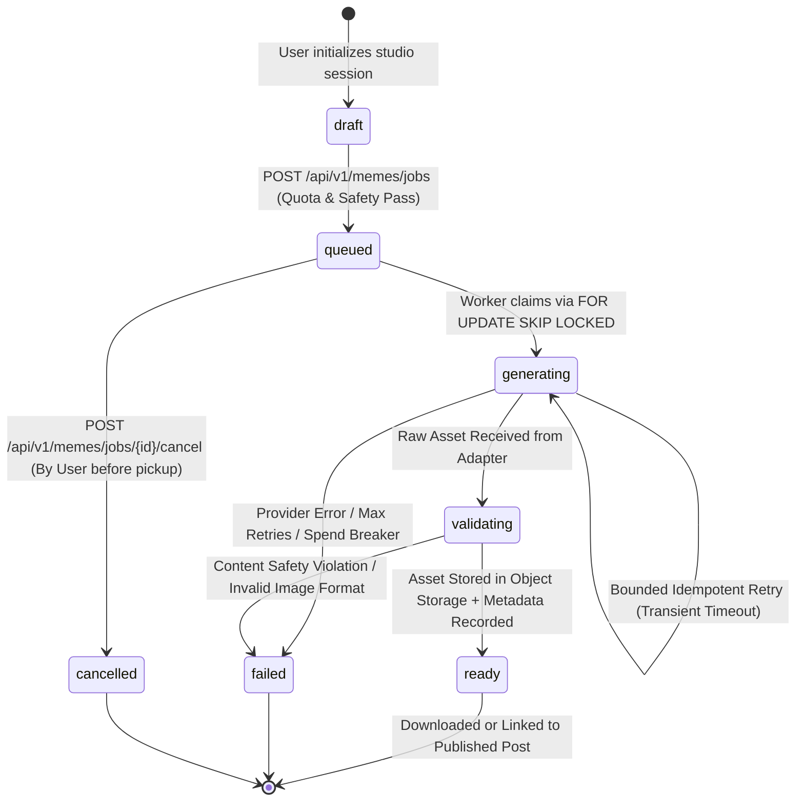

# AI Meme Studio Generation & Publication Flow

**Document ID:** DIAG-PO-005  
**Related Spec:** [AI_MEME_STUDIO.md](../architecture/AI_MEME_STUDIO.md)

## 1. AI Meme Studio End-to-End Workflow (Diagram 6)

This diagram illustrates the three creation paths inside the **AI Meme Studio**—(1) Deterministic Template Rendering, (2) AI-Assisted Captioning, and (3) Asynchronous AI Image Generation—including quota checks, provider adapters, safety validation, and direct community publication.

```mermaid
flowchart TD
    Start([User Opens /meme-studio]) --> SelectPath{Choose Creation Path}

    %% Path 1: Template + Manual or AI Captions
    SelectPath -->|Path A: Template Meme| PickTemplate[Select Curated Workplace Template]
    PickTemplate --> NeedCaption{Use AI Caption Assistant?}
    
    NeedCaption -->|No: Manual Caption| EnterText[Enter Top / Bottom / Freeform Unicode Text]
    NeedCaption -->|Yes: AI Caption| PromptCap[Enter Scenario Prompt + Tone + Language Tag]
    
    PromptCap --> CapPreflight[FastAPI Preflight:<br/>Validate Length, Strip PII, Check Daily Caption Quota]
    CapPreflight -->|Quota Exceeded / Provider Down| FallbackManual[Graceful Fallback:<br/>Show Friendly Message & Switch to Manual Caption Input]
    CapPreflight -->|Allowed| CallCapAdapter[Call CaptionProviderAdapter<br/>Sanitized Prompt + Locale + Tone]
    CallCapAdapter --> RecordCapUsage[Record Token/Cost in ai_provider_usage]
    RecordCapUsage --> ReviewCaps[User Selects & Edits Suggested Caption]
    FallbackManual --> EnterText
    ReviewCaps --> EnterText

    %% Path 2: Custom AI Image Generation
    SelectPath -->|Path B: AI Image Generation| PromptImg[Enter Image Prompt + Style + Language + Idempotency-Key]
    PromptImg --> ImgPreflight[FastAPI Preflight:<br/>Check Per-User & Global Spend Caps + Safety Policy]
    ImgPreflight -->|Blocked / Cap Reached| FallbackTemplate[Fallback to Template Meme Maker]
    ImgPreflight -->|Allowed| CreateJob[INSERT meme_jobs status='queued'<br/>Return 202 Accepted + job_id]
    
    CreateJob --> WorkerPickup[Background Worker claims Job via<br/>SELECT ... FOR UPDATE SKIP LOCKED]
    WorkerPickup --> JobGenerating[Update status='generating'<br/>Call ImageProviderAdapter with Timeout]
    
    JobGenerating -->|Timeout / Transient Error| BoundedRetry{Retry Count < Max (2)?}
    BoundedRetry -->|Yes| JobGenerating
    BoundedRetry -->|No| JobFailed[Update status='failed'<br/>Return Safe Error Code to Client]
    JobFailed --> FallbackTemplate

    JobGenerating -->|Image Returned| JobValidating[Update status='validating'<br/>Verify MIME, Dimensions, Max Size & Safety Filter]
    JobValidating -->|Passed| StoreAsset[Save to Private Object Storage<br/>INSERT meme_assets & ai_provider_usage<br/>Update status='ready']

    %% Converge at Preview & Publish
    EnterText --> RenderComposition[Render Final Meme Asset + Editable Alt Text]
    StoreAsset --> RenderComposition

    RenderComposition --> PreviewEditor[Interactive Preview: Adjust Text, Crop & Alt Text]
    PreviewEditor --> UserAction{Download or Publish?}

    UserAction -->|Download| SignedDownload[Generate Controlled Signed URL / Download PNG/WebP]
    UserAction -->|Publish to Pressure Out| ChoosePostMeta[Select Community + Identity Mode<br/>Pseudonymous / Anonymous / Professional]
    ChoosePostMeta --> PublishPost[POST /api/v1/posts with post_type='meme' & meme_asset_id]
    PublishPost --> LiveFeed([Meme Published in Community Feed])
```

## 2. Meme Job State Machine


