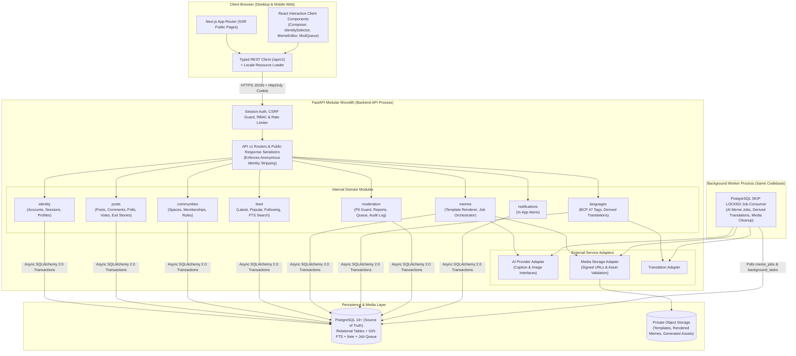
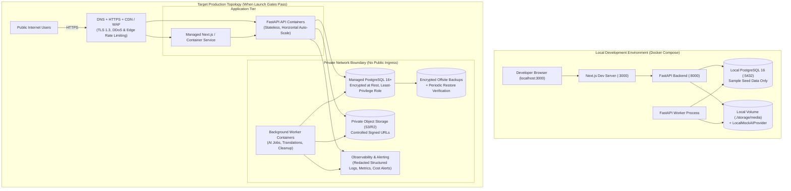

# System Components & Deployment Topology Diagrams

**Document ID:** DIAG-PO-002  
**Related Specs:** [SYSTEM_ARCHITECTURE.md](../architecture/SYSTEM_ARCHITECTURE.md), [DEPLOYMENT_AND_OPERATIONS.md](../architecture/DEPLOYMENT_AND_OPERATIONS.md)

## 1. Internal Component Architecture (Diagram 2)

This diagram illustrates the internal component boundaries across the **Next.js Frontend**, the **FastAPI Modular Monolith**, the **PostgreSQL Database**, **Object Storage**, and the **Asynchronous Background Worker**.

## 2. Deployment Architecture Across Environments (Diagram 7)

This diagram contrasts the **Local Development Environment** (zero external cloud dependencies) with the **Target Production Topology** (defense-in-depth, private network boundaries, and automated backups).

