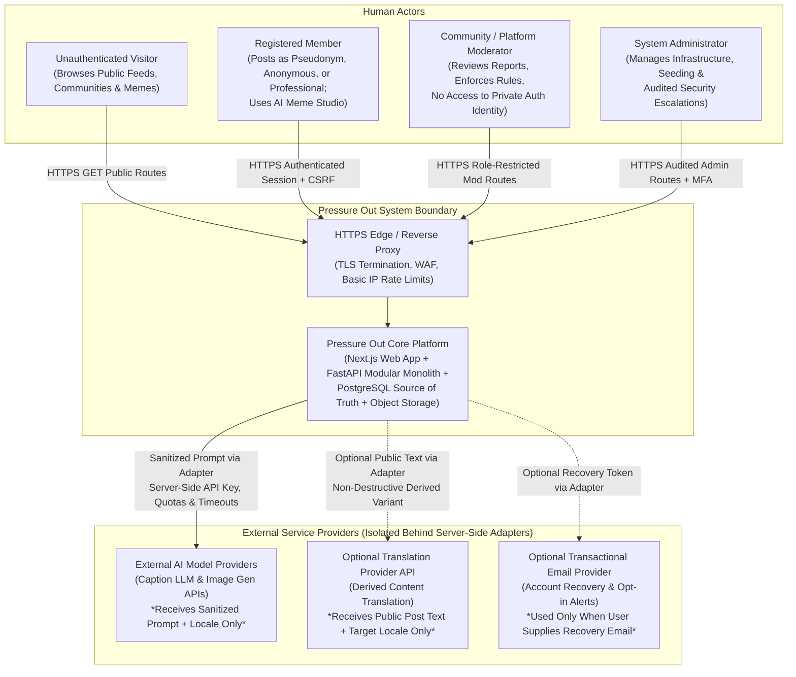

# System Context & External Actors Diagram

**Document ID:** DIAG-PO-001  
**Related Spec:** [SYSTEM_ARCHITECTURE.md](../architecture/SYSTEM_ARCHITECTURE.md)

## 1. System Context Overview (Diagram 1)

This C4-style System Context diagram illustrates how external human actors and third-party infrastructure providers interact with the **Pressure Out Platform**, highlighting strict trust and privacy boundaries.

## 2. Boundary Guarantees

1. **No Direct Browser-to-Provider Traffic:** User browsers never communicate directly with AI, translation, or email providers. All external provider keys remain strictly server-side inside the FastAPI backend/worker environment.
2. **Zero PII to AI Providers:** The `CaptionProviderAdapter` and `ImageProviderAdapter` strip all user account identifiers, session metadata, and IP addresses before dispatching generation prompts.
3. **Graceful External Independence:** Dashed links (`-.->`) indicate optional external capabilities. If `AIProvider`, `TranslationProvider`, or `EmailProvider` is unconfigured or offline, core community browsing, posting, commenting, and template meme creation continue uninterrupted.
