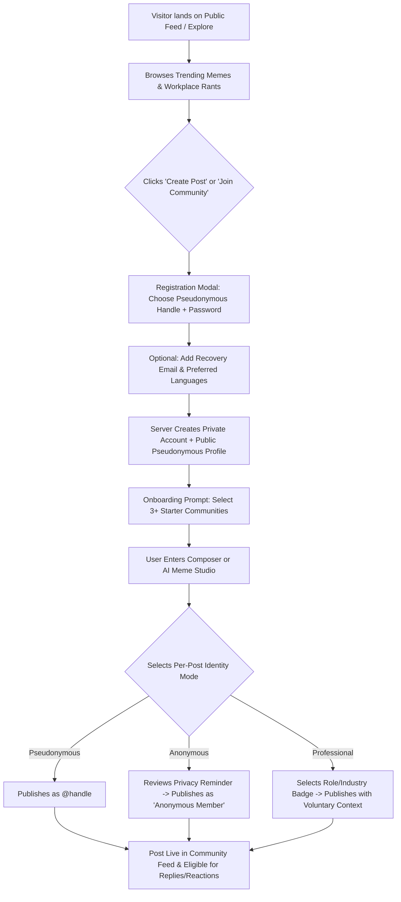

# Target Users, Personas & Core User Journeys

**Document ID:** UJ-PO-002  
**Version:** 2.0.0  

## 1. Target User Segments & Personas

Pressure Out serves working people across industries and career stages who want authentic connection without corporate surveillance.

| Persona | Profile & Workplace Context | Primary Goals on Pressure Out | Critical UX & Privacy Needs |
| :--- | :--- | :--- | :--- |
| **1. The Exhausted Individual Contributor ("Rant & Relief Riya")** | Mid-level software engineer or operations analyst dealing with micromanagement, scope creep, and unpaid overtime. | Vent anonymously after a brutal workday; feel validated by peers experiencing the same chaos. | Zero chance of her employer linking her rant to her identity; sticky `Anonymous OP` mode when replying to comments. |
| **2. The Workplace Humorist ("Meme Maker Manu")** | Junior designer or marketer who processes corporate absurdity through sarcasm and visual jokes. | Turn daily standup clichés into viral memes in under 60 seconds; build a following under a fun pseudonym. | Fast template picker, witty AI caption suggestions, mobile-friendly text positioning, and one-click download/share. |
| **3. The Career Seeker & Fresh Graduate ("Fresher Farhan")** | Final-year student or first-job graduate navigating ghosting recruiters, onboarding anxiety, and compensation offers. | Ask "stupid" questions safely, compare entry-level salary bands, and learn unwritten office survival rules. | Welcoming `c/freshers-corner` and `c/salary-talk` communities; protection from elitist gatekeeping. |
| **4. The Seasoned Mentor ("Advisor Anita")** | Engineering manager or HR partner with 10+ years of experience who wants to give honest advice without speaking "on behalf of her company." | Help juniors navigate PIPs, negotiations, and burnout while showing her role/industry for credibility. | Voluntary **Professional Display** mode (*Engineering Manager • SaaS • 10+ yrs*) per post without exposing her employer name. |
| **5. The Multilingual Professional ("Code-Switching Karthik")** | Works in English during client calls but thinks, jokes, and vents naturally in Hinglish, Tanglish, Manglish, or native scripts. | Write memes and rants in mixed languages or native scripts and discover regional workplace threads. | Clean Unicode rendering, mixed-language tag support (`mul`), and AI caption prompts that understand regional workplace slang. |
| **6. The Community Moderator ("Custodian Clara")** | Trusted community volunteer or platform safety specialist keeping discussions healthy. | Quickly triage reported posts, remove doxxing/PII, and stop brigading without reading users' private data. | Least-privilege moderation queue, one-click PII redaction/removal, mandatory reason codes, and zero access to private author emails/IPs. |

## 2. Core User Journeys

### Journey 1: Low-Friction Registration to First Participation (Diagram 8)

Users can browse public feeds first and register in under 30 seconds without providing a real name or work email.

### Journey 2: Anonymous Venting & Safe OP Replies
1. **Trigger:** User finishes a frustrating performance review and wants to vent without tying the story to their regular `@handle`.
2. **Action in Composer:**
   * Selects community `c/workplace-rants` and post type `Rant`.
   * Switches the prominent **Identity Selector** pill from `@handle (Pseudonymous)` to `Anonymous Member`.
   * Writes post body.
3. **Pre-Publish Safety Check:**
   * If the user accidentally typed an email address, phone number, or a phrase like *"My manager Rahul Sharma at Infosys..."*, a non-blocking **Privacy & PII Guardrail banner** highlights the phrase and suggests generalizing it (e.g., *"My senior manager at a large IT services firm..."*).
4. **Publication:**
   * Backend stores `author_user_id` privately on the `posts` row, sets `identity_mode = 'anonymous'`, and generates a post-scoped `anonymous_alias` (e.g., `Anonymous OP`).
   * Public API payload returns `author: { display_mode: "anonymous", display_name: "Anonymous Member", profile_url: null }`.
5. **Safe Follow-Up Replies:**
   * Other users comment on the post. The author receives an in-app notification.
   * When the author opens the thread to reply, the comment box **automatically locks to `Anonymous OP`** with a visual lock badge so they cannot accidentally reply under their `@handle` without explicitly unlocking it.

### Journey 3: Creating & Publishing a Meme in AI Meme Studio
1. **Trigger:** User wants to make a meme about "Return to Office (RTO) mandates for teams that still spend 8 hours on Zoom."
2. **Step 1 — Mode Selection:** User opens `/meme-studio` and chooses between:
   * **Tab A: Template + AI Caption Assistant** (Fastest, default).
   * **Tab B: Custom AI Image Generator**.
3. **Step 2 — Prompt & Captioning:**
   * User enters scenario: *"Forced to commute 90 minutes to the office just to sit on video calls all day"* and selects tone `Sarcastic` and language `English`.
   * Backend validates prompt length/safety and calls `CaptionProviderAdapter`.
   * UI displays 4 generated caption pairs and recommends matching templates (e.g., *Clown Makeup*, *Drake Hotline*, *Two Buttons*).
4. **Step 3 — Visual Editing & Accessibility:**
   * User picks a template or generates a custom AI background image (polling `GET /api/v1/memes/jobs/{job_id}` while status transitions `queued -> generating -> validating -> ready`).
   * User tweaks text position/font size in the canvas preview and reviews the auto-populated `alt_text` field.
5. **Step 4 — Download or Publish:**
   * User can download the rendered PNG/WebP directly or click **Publish to Community**, pick `c/corporate-memes`, choose their `identity_mode`, and post immediately.

### Journey 4: Sharing a Structured Resignation / Exit Story
1. **Trigger:** User leaves a toxic or stagnating role and wants to share lessons learned with peers.
2. **Step 1 — Composer Selection:** Selects post type `Workplace Experience / Exit Story` in `c/resignation-stories`.
3. **Step 2 — Structured Metadata (Optional):**
   * Selects up to 3 primary departure reasons from standardized tags (`compensation`, `toxic_management`, `burnout`, `rto_mandate`, `lack_of_growth`, `layoff_restructuring`, `better_opportunity`).
   * Optionally selects broad `industry`, `role_level`, and `tenure_band` (never forced to name the specific employer).
4. **Step 3 — Narrative & Privacy Check:** Writes the story, selects `Anonymous` or `Pseudonymous` mode, passes the PII check, and publishes.

### Journey 5: Multilingual Reading & On-Demand Translation
1. **Trigger:** User browsing `c/office-humour` encounters a popular post written in Hindi (`hi`) or mixed Hinglish (`mul`).
2. **Step 1 — Native Rendering:** The post renders cleanly in its original script/language with a subtle language badge (`HI` / `Mixed`).
3. **Step 2 — Optional Translation:** User clicks **Translate to English**.
4. **Step 3 — Non-Destructive Display:**
   * Backend checks if a cached `post_translations` record exists for `(post_id, target_locale='en')`; if not, invokes `TranslationProviderAdapter`.
   * UI displays the translated text beneath a clear header: *"Translated from Hindi by AI • Show Original"*. The original text is never overwritten.

### Journey 6: Reporting & Proportionate Moderation
1. **Trigger:** A user spots a comment that reveals a coworker's personal mobile number and full name.
2. **Step 1 — Reporting:** User clicks `Report` -> selects `Doxxing / Personal Information` -> submits.
3. **Step 2 — Automated Triage:** Because `doxxing_pii` is a high-severity category (or if multiple unique reporters flag the item), the system places the comment in the high-priority Moderation Queue (and can auto-hold visibility pending review if threshold rules trigger).
4. **Step 3 — Moderator Action:**
   * Moderator opens `/moderation/queue`, sees the flagged comment and surrounding thread context, **without** seeing the author's private email or IP address.
   * Moderator selects `Remove — PII / Doxxing Violation`, adds a mandatory reason note, and submits.
5. **Step 4 — Audit & Appeal:**
   * System hides the comment, records an immutable entry in `audit_events`, and sends an in-app notification to the author explaining the rule violated and providing a link to submit an **Appeal**.
