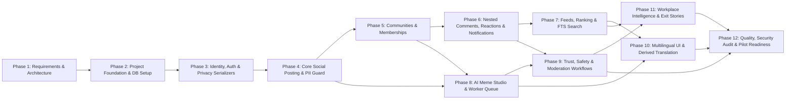

# Dependency-Aware Implementation Roadmap (Phases 1–12)

**Document ID:** ROAD-PO-001  
**Version:** 2.0.0  

## 1. Roadmap Ordering & Critical Technical Dependencies

While the baseline 12-phase sequence provides a logical progression, our architectural analysis identified **three cross-cutting technical dependencies** that must be pulled forward into earlier phases so later phases never require schema or serializer rewrites:

1. **Unicode & BCP 47 Language Columns Pulled to Phase 2 & 4:** Even though full UI localization and derived translation happen in **Phase 10**, PostgreSQL UTF-8 collation, NFC normalization, and the `content_language` column on `posts`/`comments` must be created in **Phase 2 & 4**.
2. **Five-Layer Identity Serializer & Sticky `Anonymous OP` Rule Pulled to Phase 3, 4 & 6:** The public/private serializer split is established in **Phase 3** and strictly applied when `posts` (**Phase 4**) and `comments` (**Phase 6**) are built.
3. **Storage Adapter & `meme_assets` FK Pulled to Phase 4 / Phase 8 Boundary:** `posts` includes the nullable `meme_asset_id` column from **Phase 4** so **Phase 8 (AI Meme Studio)** plugs into the post feed with zero breaking migration on `posts`.

## 2. Phase-by-Phase Execution Plan

### Phase 1 — Requirements and Architecture (CURRENT PHASE — COMPLETE)
* **Entry Conditions:** Product vision and baseline architecture proposal provided.
* **Deliverables:** Complete PRD, user journeys, MVP scope, system/frontend/backend/DB/API/privacy/AI/multilingual/moderation/deployment specs, 8 Mermaid diagrams, 10 ADRs, testing strategy, risk register, and this 12-phase roadmap.
* **Verification / Exit Criteria:** All Phase 1 acceptance criteria (Section 20) verified; zero broken internal markdown references.

### Phase 2 — Project Foundation
* **Entry Conditions:** Phase 1 specifications approved.
* **Deliverables:**
  * Monorepo directory scaffold (`frontend/`, `backend/`, `docker-compose.yml`, `.env.example`).
  * FastAPI app factory, structured redacted JSON logger, unified error handler, `/api/v1/health` endpoint.
  * Async SQLAlchemy 2.0 + Alembic migration setup with PostgreSQL extensions (`pgcrypto`, `citext`, `ltree`, `pg_trgm`) and UTF-8 NFC validation helpers.
  * Next.js App Router + TypeScript + Tailwind CSS + accessible base UI primitives + externalized `locales/en/common.json` loader.
  * Automated CI/local test runners (`pytest`, `ruff`, `vitest`, `eslint`, `tsc`).
* **Required Tests:** DB connection & migration round-trip (`upgrade head` -> `downgrade base` -> `upgrade head`), health check API test, frontend smoke render test.
* **Completion Criteria:** `docker compose up` starts cleanly; all baseline linters and smoke tests pass.

### Phase 3 — Identity and Privacy
* **Entry Conditions:** Phase 2 foundation passing.
* **Deliverables:**
  * Tables & models: `users`, `user_sessions`, `public_profiles`, `professional_profiles`.
  * Argon2id password hashing, optional AES-GCM encrypted recovery email, backup recovery code generation.
  * Cookie session middleware (`HttpOnly`, `SameSite=Lax`) + `X-CSRF-Token` verification + rate limiting on `/api/v1/auth/*`.
  * Endpoints: `register`, `login`, `logout`, `recovery`, `GET/PATCH/DELETE /api/v1/me`, `GET /api/v1/profiles/{handle}`.
  * Frontend pages: `/auth/register`, `/auth/login`, `/auth/recovery`, `/settings/profile`, `/settings/privacy`, `/u/[handle]`.
* **Required Tests:** Auth lifecycle tests, CSRF rejection tests, session revocation tests, and strict schema tests proving `PublicProfileResponse` never exposes `user_id` or email fields.
* **Completion Criteria:** Users can register without a real name or employer, configure an optional professional profile, manage sessions, and delete their account.

### Phase 4 — Core Social Posting
* **Entry Conditions:** Phase 3 complete.
* **Deliverables:**
  * Tables & models: `posts`, `polls`, `poll_options`, `poll_votes`, `tags`, `post_tags` (including `content_language` and `identity_mode`).
  * Synchronous Pre-Publish PII Guardrail (`pii_guard.py`) flagging emails, phones, secrets, and named manager patterns.
  * `PublicPostSerializer` enforcing 3-mode identity rendering (`pseudonymous`, `anonymous`, `professional`) and filtering `anonymous` posts out of `/u/[handle]`.
  * Frontend `PostComposer` with prominent `IdentityModeSelector`, `LanguageTagSelect`, and `PostCard` / `/p/[postId]` detail view.
* **Required Tests:** Automated **Privacy Leak Test Suite** verifying zero `author_user_id`/`handle` leakage on anonymous posts across all endpoints; author edit/delete authorization tests; PII scanner unit tests.
* **Completion Criteria:** All media-independent post types (`discussion`, `question`, `rant`, `story`, `poll`, `advice_request`) can be created, edited, viewed, and deleted with verified identity isolation.

### Phase 5 — Communities
* **Entry Conditions:** Phase 4 complete.
* **Deliverables:**
  * Tables & models: `communities`, `community_rules`, `community_memberships`.
  * Seed script populating the 11 core workplace communities (*Workplace Rants*, *Corporate Memes*, *Career Advice*, *IT & Software*, *Salary Talk*, *Job Hunting*, *Freshers' Corner*, *Work-Life Balance*, *Startup Life*, *Office Humour*, *Resignation Stories*).
  * Endpoints & UI for `/communities` directory, `/c/[slug]` community page, rules drawer, and join/leave membership toggles.
* **Required Tests:** Membership idempotency tests, restricted/banned community posting rejection tests, community feed filtering tests.
* **Completion Criteria:** Users can browse communities, join/leave, view community rules, and publish posts scoped to a community.

### Phase 6 — Comments, Engagement & Notifications
* **Entry Conditions:** Phase 5 complete.
* **Deliverables:**
  * Tables & models: `comments` (with `ltree` path), `votes`, `reactions`, `saved_posts`, `notifications`.
  * Sticky `Anonymous OP` comment rule enforcement in backend (`OP_ANONYMITY_MISMATCH` guard) and frontend (`AnonymousOpLockBanner`) plus deterministic per-thread anonymous labels (`Anonymous • 4F2A`).
  * Upvote/downvote toggles, 5 workplace reactions (`relatable`, `laugh`, `support`, `oof`, `respect`), bookmarks (`/saved`), and in-app `/notifications` inbox.
* **Required Tests:** Concurrent vote race-condition tests, `ltree` subtree cursor pagination tests, Sticky `Anonymous OP` protection tests, notification creation tests.
* **Completion Criteria:** Threaded discussions, voting, reactions, bookmarks, and reply notifications pass end-to-end tests without loading entire large threads at once.

### Phase 7 — Feed, Ranking & Discovery
* **Entry Conditions:** Phase 6 complete.
* **Deliverables:**
  * Feed ranking engine implementing `Latest`, `Popular` (time-decayed engagement score with anti-outrage dampening), `Following` (joined communities & tags), and `Explore` ("Fresh Posts" rail for new communities).
  * PostgreSQL Full-Text Search (`tsvector` GIN index) powering `GET /api/v1/search` with filters for `community_slug`, `post_type`, and `content_language`.
* **Required Tests:** Ranking formula determinism tests, cursor pagination stability tests under concurrent inserts, FTS search accuracy and visibility filter tests (ensuring removed/restricted posts never appear in search).
* **Completion Criteria:** All 4 feeds and search operate with p95 < 250ms on a 50k-post synthetic dataset.

### Phase 8 — AI Meme Studio
* **Entry Conditions:** Phase 4 & 5 complete.
* **Deliverables:**
  * Tables & models: `meme_templates`, `meme_jobs`, `meme_assets`, `ai_provider_usage`.
  * Curated copyright-safe starter templates + deterministic server-side `TemplateRenderer` (Pillow + HarfBuzz + Noto fonts).
  * `CaptionProviderAdapter` and `ImageProviderAdapter` interfaces, `LocalMockAIProvider`, and configurable HTTP provider adapter.
  * Background worker runner (`app/workers/runner.py`) polling `meme_jobs` via `FOR UPDATE SKIP LOCKED`, enforcing per-user daily quotas, timeouts, bounded retries, and global spend circuit breaker.
  * Frontend `/meme-studio` page (Template editor, AI Caption Assistant drawer, async AI Image job status poller, `alt_text` editor, download & publish-to-community flow).
* **Required Tests:** Provider timeout/failure fallback tests, quota enforcement (`429`) tests, idempotency key deduplication tests, prompt PII stripping tests, Unicode caption rendering tests.
* **Completion Criteria:** Users can create, preview, download, and publish template memes and AI-assisted memes; disabling the AI provider degrades gracefully to template creation without affecting the social feed.

### Phase 9 — Trust, Safety & Moderation
* **Entry Conditions:** Phase 6 & 8 complete.
* **Deliverables:**
  * Tables & models: `reports`, `moderation_actions`, `moderation_appeals`, `user_blocks`, `audit_events`.
  * Report submission modal, velocity-based auto-hold for high-severity (`doxxing_pii`, `threat`) reports, bidirectional user blocking/muting.
  * Moderator UI (`/moderation/queue`, `/moderation/appeals`) and Admin UI (`/moderation/audit`) enforcing blind anonymous author isolation and mandatory reason codes.
* **Required Tests:** Moderator RBAC tests (verifying moderators cannot see private `author_user_id` or emails), appeal separation-of-duties tests, blocked-user content filtering tests, immutable audit log tests.
* **Completion Criteria:** End-to-end report -> triage -> moderation action -> author notification -> appeal workflow verified.

### Phase 10 — Multilingual Experience
* **Entry Conditions:** Phase 7 & 8 complete.
* **Deliverables:**
  * Table & model: `content_translations` + `TranslationProviderAdapter`.
  * Additional UI locale catalogs (e.g., Hindi `hi`, Spanish `es`) and `UiLocaleSwitcher`.
  * On-demand post/comment translation endpoint (`POST /api/v1/posts/{id}/translations`) and non-destructive *"Translated from [Language] — Show Original"* UI toggle.
  * Language capability matrix wiring for Meme Studio prompts and feed language filters.
* **Required Tests:** Multi-script round-trip rendering tests (Devanagari, Malayalam, Tamil, Arabic RTL, CJK), translation cache invalidation on source edit tests, graceful fallback on translation outage tests.
* **Completion Criteria:** Users can browse in multiple UI locales, filter feeds by preferred languages, and view optional derived translations without altering original posts.

### Phase 11 — Workplace Intelligence (Exit Stories & Insights)
* **Entry Conditions:** Phase 7 & 9 complete.
* **Deliverables:**
  * Table & model: `exit_story_details`.
  * Structured Exit Story composer mode (`primary_reasons`, `industry`, `role_level`, `tenure_band`, `morale_rating`).
  * Privacy-conscious aggregated insights view (`/insights/exit-stories`) enforcing a strict **k-anonymity minimum sample size (`n >= 25` stories in time window)** before rendering any industry or role breakdown.
* **Required Tests:** k-anonymity suppression tests (verifying cohorts with `n < 25` return suppressed/hidden aggregates), exit story creation and privacy tests.
* **Completion Criteria:** Structured exit stories and sample-size-protected aggregate insights pass functional and privacy verification.

### Phase 12 — Quality, Security Audit & Launch Readiness
* **Entry Conditions:** Phases 2–11 complete.
* **Deliverables:**
  * Full Playwright E2E regression suite, axe-core accessibility audit fix pass, database backup/restore verification script, operational runbooks, and legal/policy review sign-off against the Section 22 Launch Checklist.
* **Required Tests:** Full E2E suite, load/latency benchmark, security/privacy penetration test suite, backup restore drill.
* **Completion Criteria:** All Launch Readiness Checklist items verified for controlled pilot launch.
